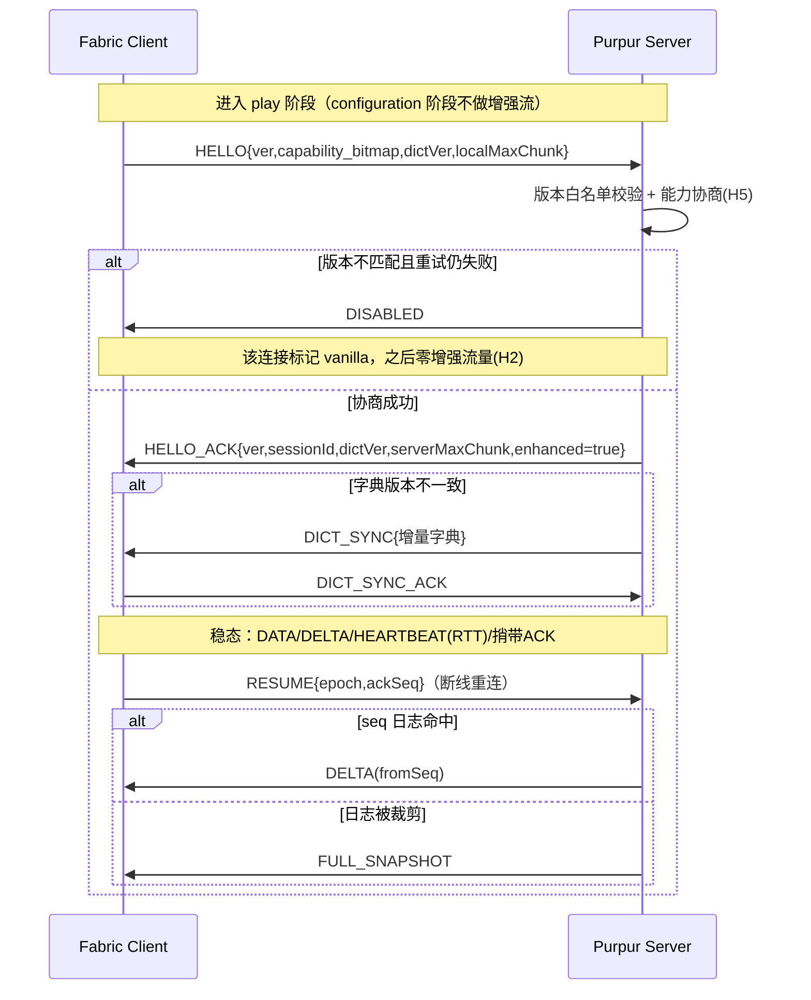

# 03 · 架构与帧规范（第 2.1–2.7 阶段）

## 3.1 分层架构 L0–L6

| 层 | 名称 | 职责 | 关键类 |
|---|---|---|---|
| L0 | 承载 | play 阶段 custom payload，通道 `purpurflow:main` | `ChannelRegistrar`, `PayloadRegistrations` |
| L1 | 帧层 | 一帧多消息合包 + 大消息分片重组 | `Frame`, `FrameCodec`, `Fragmenter`, `Reassembler`, Fabric `registerLarge` |
| L2 | 编码 | VarInt/ZigZag、bitfield、字典 ID、BlockPos、定点化 | `VarInts`, `BitPacker`, `DictRegistry` |
| L3 | 语义 | 快照 + delta + 脏位图 + 幂等序号 + 可靠性分级 | `Snapshot`, `Delta`, `DirtyBitmap`, `SeqTracker`, `DedupWindow` |
| L4 | 压缩 | 帧级自适应、可插拔、**默认关闭** | `CompressionCodec`（接口 + Noop 默认实现） |
| L5 | 控制 | 握手、字典同步、心跳/RTT、重连补偿、优先级与速率 | `Handshake`, `CapabilityNegotiator`, `ResumeService`, `RateLimiter` |
| L6 | 兼容 | 能力探测与 vanilla 降级 | `CapabilityProbe`, `VanillaFallback` |

**「深度配合」的定义**：双端共享同一 `common` 协议模块、字典版本对齐、能力协商、状态基线对齐；服务端能感知客户端能力并下发差异化数据（装 Mod 的拿 delta，未装的什么都不发）。

```
        ┌───────────────────── 同一条 MC TCP 连接（play 阶段） ─────────────────────┐
        │                                                                          │
  [Purpur 插件]  ←── purpurflow:main custom payload (双向) ──→  [Fabric Client Mod] │
        │                                                                          │
        └──────── 两端共享 common 模块：FrameCodec / Dict / Delta / Control ────────┘
                 （零 MC 依赖，Java 21，字典版本对齐）
```

## 3.2 帧格式（字段位宽与含义）

```
magic(2B) | ver(u8) | flags(u8) | session(u32) | seq(varint) | ack(varint)
   | dictVer(u16) | type(varint) | len(varint) | payload(len) [| crc(4B,可选)]
```

| 字段 | 位宽 | 含义 |
|---|---|---|
| `magic` | 2 B | 固定 `0x50 0x46`（"PF"），快速识别本工程帧，错则丢弃 |
| `ver` | u8 | 协议版本号，白名单校验，不匹配走降级 |
| `flags` | u8 | 位标志（见下表） |
| `session` | u32 | 会话 ID，每连接唯一，重连 epoch 另计 |
| `seq` | varint | 单调递增序号，每会话独立；`ack` 捎带确认，不单独发 ACK 包 |
| `ack` | varint |  Piggyback 确认收到的最大 seq |
| `dictVer` | u16 | 字典版本，不对齐触发 `DICT_SYNC` |
| `type` | varint | 消息类型（控制帧或业务帧 ID） |
| `len` | varint | payload 长度 |
| `payload` | len B | 消息体；**合包时可含多条 `(type,len,payload)`** |
| `crc` | 4 B 可选 | CRC32，`flags.crc` 置位时存在；弱网高丢包时可开 |

### flags 位定义

| bit | 名称 | 含义 |
|---|---|---|
| 0 | `MORE` | 分片未结束 |
| 1 | `FRAG` | 本帧是分片（携带 index） |
| 2 | `COMPRESSED` | payload 经 L4 压缩 |
| 3 | `CRC` | 尾部带 CRC32 |
| 4-5 | `RELIABILITY` | 00 可丢弃 / 01 尽力 / 10 可靠有序 / 11 保留 |
| 6-7 | `PRIORITY` | 00 控制 / 01 关键状态 / 10 遥测 / 11 保留 |

> 【工程建议】分片 index 采用独立的 varint 字段附着在分片帧 payload 头部（不在 flags 里挤位），重组缓冲有大小与超时上限，超时即丢弃并请求增量补发，不无限等待。

### 帧总长与上限（运行时探测，不硬编码）

- 单帧总长上限：取「链路实际 payload 上限 − 预留头空间」，服务端从 `HELLO.localMaxChunk` 读取客户端声明，客户端用 Fabric `registerLarge` 的 `IntSupplier` 动态决定。
- 单逻辑消息上限：独立配置，超限直接拒绝并计入安全计数（见 2.9）。
- 上行走 32 KiB 限、下行走 1 MiB 限（已证实，见 01 文档）。

## 3.3 编码层（减少单条字节数）

| 技术 | 用途 | 精度损失 |
|---|---|---|
| VarInt / VarLong | 所有整数字段 | 无 |
| ZigZag | 有符号小幅值（坐标差、delta） | 无 |
| bitfield | 布尔与小枚举打包 | 无 |
| 字典 ID | 重复字符串 / 资源键 → u16 ID | 无（字典版本化） |
| UUID 两个 long | 替代 36 字符字符串 | 无，省 ~20 B |
| BlockPos 打包 | `((x&0x3FFFFF)<<38)\|((z&0x3FFFFF)<<12)\|(y&0xFFF)` | 无（在有效范围内） |
| 定点化 | 坐标/血量按实际精度缩放 | **可选，需标注精度损失** |

**禁止**：Java 原生序列化、JSON、NBT 文本化作为高频载荷。

## 3.4 字典表（双端共享，版本化）

| 字典 | 内容 | 同步时机 |
|---|---|---|
| `STRINGS` | 任务 id、经济类型、领地键等重复字符串 | 握手 `DICT_SYNC` 增量 |
| `RESOURCE_KEYS` | 资源键 / 命名空间 ID | 握手 |
| `ENUM_MAP` | 枚举 → u16 ID | 握手 |

字典由握手同步，版本化（`dictVer`），可增量更新；回滚时按 `dictVer` 回退到上一版快照（见 07 文档）。

**字典表结构示例（黄金向量见 06 文档）**：

| ID | 字符串 |
|---|---|
| 0 | `quest.daily` |
| 1 | `quest.weekly` |
| 2 | `eco.balance` |
| 3 | `claim.enter` |

## 3.5 语义层：delta + 脏位图 + 幂等

- 服务端维护每玩家状态快照，变更只发 **delta + 脏位图**（按字段位标记，而非整对象重发）。
- 按 `seq` 幂等去重（去重窗口大小可配，默认 256）。
- 可靠性分级：控制帧与关键状态 = 可靠有序；高频遥测/装饰性数据 = 可丢弃、最新覆盖旧值。
- 可丢弃帧在队列积压时直接合并为一次脏位图批量，不排队重发。

## 3.6 压缩层（默认关闭）

- 规则：仅当帧超过阈值且实测净收益为正才压缩；小包不压（压缩头开销 + CPU 反而更亏）。
- 优先字典/低 CPU 方案；压缩算法可插拔且**默认关闭**，由压测数据决定是否开启。
- 压缩与编码顺序：编码(字典化+delta) → [可选压缩] → 成帧。与 `network-compression-threshold` 的相互作用见 07 文档。
- A/B 压测口径见 06 文档。

## 3.7 控制面时序（握手状态机）

Mermaid 版（支持渲染的 MarkDown 查看器可直接看图）：



文本版：

```text
 Client                                             Server
   |  ——(进入 play 阶段)———————————————————————→      |
   |  HELLO{ver, capability_bitmap, enc/comp, localMaxChunk}  |
   |                                                        |
   |  ←—— HELLO_ACK{ver_selected, sessionId, dictVer, serverMaxChunk, enhanced=true/false} ——|
   |                                                        |
   |  [若 dictVer 不一致] ←—— DICT_SYNC{增量字典} ——          |
   |  —— DICT_SYNC_ACK ——————————————————————————————→      |
   |                                                        |
   |  ←—— DATA / DELTA / HEARTBEAT(RTT) / 捎带 ACK ——→       |  (稳态)
   |                                                        |
   |  [暂停时] 低频 HEARTBEAT 维持，不刷屏                    |
   |                                                        |
   |  [断线重连] RESUME{epoch, ackSeq} —————————————————→    |
   |  ←—— FULL_SNAPSHOT 或 DELTA(fromSeq) ——                 |
   |                                                        |
   |  [版本不匹配] 降版本重试一次 → 仍不匹配 → DISABLED      |
   |              该连接标记 vanilla，之后零增强流量         |
```

**超时纪律**：握手所有消息有超时；超时即降级，不阻塞玩家进服。

### 握手状态机（H5）

```
        ┌─────────┐
        |  WAIT_HELLO |
        └────┬────┘  timeout ──────────────┐
             | HELLO                        │
        ┌────▼────┐                         │
        | NEGOTIATE |  mismatch             │
        └────┬────┘  ── retry once ──┐      │
             | ok                    │      │
        ┌────▼────┐            ┌─────▼──┐    │
        | DICT_SYNC|            │ DISABLED│←──┘
        └────┬────┘            └────────┘
             | ack
        ┌────▼────┐
        |  STEADY  | ←—— RESUME ——→ RESUMING
        └─────────┘
```

**任何异常分支都不得抛到主线程或触发踢人逻辑。**

## 3.8 优化前后字节对照表（【工程建议】基线，验收以实测为准）

以「玩家状态批量更新」为例（20 个字段变更 + 1 个任务进度）：

| 方案 | 字节 | 包数 | 说明 |
|---|---|---|---|
| 原版逐字段（JSON 键名） | ~1200 B | 21 | 每字段一个包，键名重复 |
| 二进制整对象 | ~180 B | 1 | 无 delta |
| **本方案：delta+脏位图+字典+合包** | **~48 B** | **1** | 脏位图 4 B + 变更值 + 字典 ID |
| 本方案 + 帧级压缩 | ~40 B | 1 | 默认关闭，仅大帧净收益时开 |

关键：**包数从 21 → 1** 是最大杠杆；字节从 ~1200 B → ~48 B。有效载荷比与每逻辑更新平均字节的实测口径见 06 文档。
